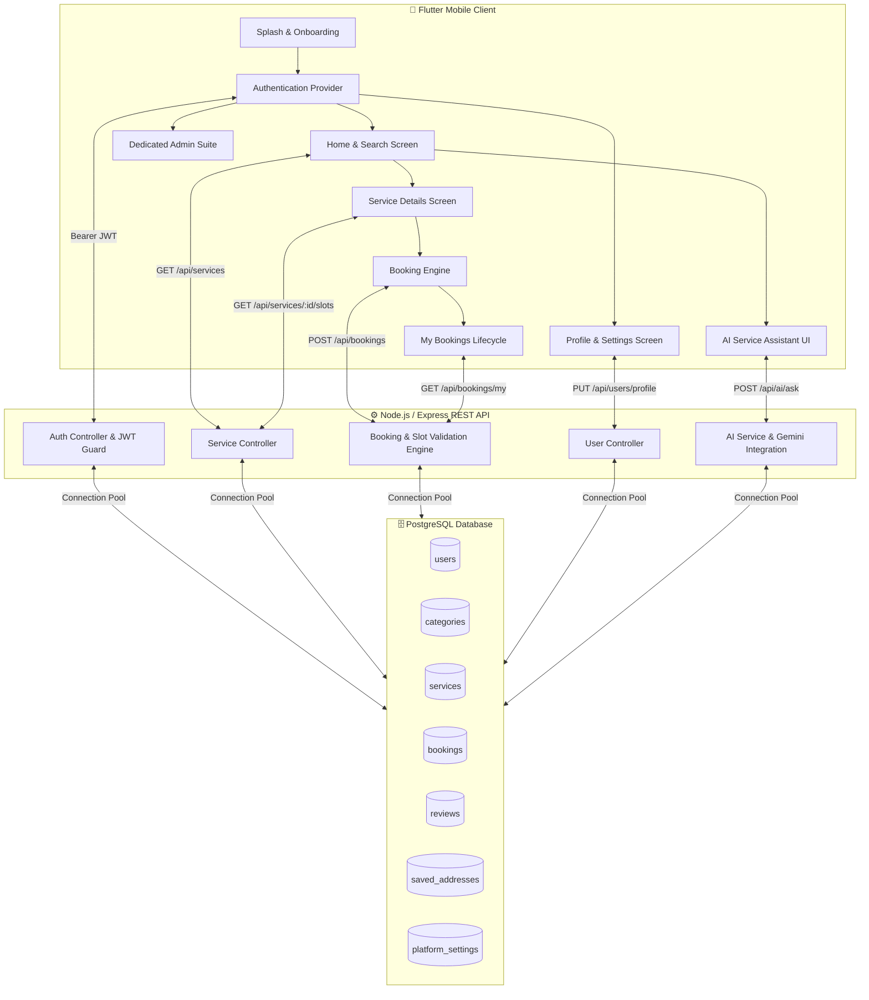

# 🏡 ServiceHub — Service Booking & Management System

> **A Complete Cross-Platform Mobile & Backend Solution with AI Assistance**  
> Developed as part of the **Technical Assessment (Deadline: 72 Hours)**.  
> Author: **Shakil Ahamed** (`shakil@example.com` / `shakil.dev@servicehub.app`)

---

## 🔗 Project Repositories

| Component | GitHub Repository | Tech Stack | Status |
| :--- | :--- | :--- | :---: |
| 📱 **Mobile Application** | [**service_booking_app**](https://github.com/devshakilinfo/service_booking_app) | Flutter 3.x, Dart, Provider, REST API | ✅ Production Ready |
| ⚙️ **Backend REST API** | [**service_booking_backend**](https://github.com/devshakilinfo/service_booking_backend) | Node.js, Express, PostgreSQL, JWT, Gemini AI | ✅ Production Ready |
| 📑 **Master Documentation** | [**service_booking_management**](https://github.com/devshakilinfo/service_booking_management) | Unified Architecture, Postman, DB Schema | ✅ Active |

---

## 🌟 Executive Project Overview

**ServiceHub** is an end-to-end, enterprise-grade service booking and management platform designed with **Clean Architecture, responsive UI/UX, relational data integrity, and secure server-mediated AI integration**.

### Core Capabilities:
1. **Cross-Platform Mobile App (Flutter):**
   - 100% pixel-accurate implementation adhering to the official design mockups.
   - Provider state management with separation of concerns (`core`, `models`, `providers`, `screens`, `widgets`).
   - Clean, zero-warning codebase verified with `flutter analyze`.

2. **Robust Backend API (Node.js & Express):**
   - RESTful API with route protection using JWT.
   - Password hashing with Bcrypt (salt rounds: 10).
   - Dynamic time-slot availability engine with **strict conflict prevention** (`409 Conflict` on double bookings).

3. **Relational Database (PostgreSQL):**
   - PostgreSQL relational schema with foreign key constraints, cascading deletes, and targeted indexing.
   - Pre-seeded with 6 categories, 14 diverse services, 6 test users, 10 realistic bookings across all statuses, verified reviews, saved addresses, and platform configs.

4. **🤖 AI Service Assistant (Google Gemini AI):**
   - Secure backend-mediated LLM communication—**zero API keys exposed in the Flutter app**.
   - Context-grounded recommendations with interactive service preview cards directly in chat with "Quick Book →" shortcuts.

---

## 🏗️ System Architecture



---

## 📋 Technical Assessment Compliance Matrix

| Requirement | Implementation Details | Status |
| :--- | :--- | :---: |
| **User Registration** | `POST /api/auth/register` with validation & password hashing | ✅ Complete |
| **Secure Login & Logout** | `POST /api/auth/login` with JWT + persistent session via `SharedPreferences` | ✅ Complete |
| **Form Validation** | Email regex, password length, required fields & error state handling | ✅ Complete |
| **Available Services Listing** | 2-column grid and horizontal carousel with image, price, duration & ratings | ✅ Complete |
| **Search & Filtering** | Real-time text search and 6 category chips (`Cleaning`, `Repair`, `Beauty`, `Health`, `Electric`, `Painting`) | ✅ Complete |
| **Featured & Popular Services** | Tagged services with custom badges and review badges | ✅ Complete |
| **Service Details** | Hero image, pricing, duration, inclusion checklist, verified specialist card | ✅ Complete |
| **Appointment Booking** | 14-day date selector, 9 daily time slots, address prefill, notes | ✅ Complete |
| **Booking Confirmation** | Leaf-halo receipt modal (#SH-8492) with summary | ✅ Complete |
| **Conflict Prevention** | Database-level and controller-level locking of booked/pending slots | ✅ Complete |
| **My Bookings Lifecycle** | Tabbed views for `Upcoming`, `Completed`, `Cancelled` with status pills | ✅ Complete |
| **Appointment Cancellation** | Cancellation endpoint with cancellation reason recording | ✅ Complete |
| **User Profile Management** | Full name, phone, address editing with persistence to PostgreSQL | ✅ Complete |
| **Change Password** | Bcrypt comparison and updating | ✅ Complete |
| **AI Integration** | Gemini AI chat assistant recommending services with interactive booking cards | ✅ Complete |
| **Backend & Database** | Node.js, Express, PostgreSQL relational schema with connection pooling | ✅ Complete |

---

## 🗄️ Database Design & Schema

The relational schema is configured in PostgreSQL:

- **`users`**: `id`, `name`, `email` (UNIQUE), `password`, `phone`, `address`, `avatar`, `role`, `is_verified`, `created_at`.
- **`categories`**: `id`, `name` (UNIQUE), `icon`, `description`, `is_active`.
- **`services`**: `id`, `name`, `description`, `category`, `price`, `duration`, `image`, `rating`, `reviews_count`, `is_featured`, `is_popular`, `highlights`, `available_slots`, `is_active`.
- **`bookings`**: `id`, `user_id` (FK), `service_id` (FK), `date`, `time_slot`, `status` (`Pending`, `Confirmed`, `Completed`, `Cancelled`), `total_price`, `notes`, `cancellation_reason`.
- **`reviews`**: `id`, `user_id` (FK), `service_id` (FK), `rating`, `comment`.
- **`saved_addresses`**: `id`, `user_id` (FK), `label`, `address`, `is_default`.
- **`platform_settings`**: `id`, `platform_name`, `commission_rate`, `support_email`, `auto_confirm_bookings`, `slot_buffer_time`, `free_cancellation_window`.

> Full Schema & ER Diagram Documentation: [**docs/DATABASE_SCHEMA.md**](docs/DATABASE_SCHEMA.md)

---

## 📡 REST API Reference

Full Postman Collection available: [**docs/ServiceHub_Postman_Collection.json**](docs/ServiceHub_Postman_Collection.json).

### 1. Authentication Endpoints
- `POST /api/auth/register` — Create a new user account.
- `POST /api/auth/login` — Authenticate and receive JWT token.

### 2. Services Endpoints
- `GET /api/services` — Fetch all active services (supports `?category=Cleaning&search=Deep`).
- `GET /api/services/categories` — Retrieve all 6 service categories.
- `GET /api/services/:id` — Get detailed information for a specific service.
- `GET /api/services/:id/slots?date=YYYY-MM-DD` — Retrieve available time slots with booked-slot exclusion.

### 3. Bookings Endpoints
- `POST /api/bookings` *(Protected)* — Create a new appointment booking.
- `GET /api/bookings/my` *(Protected)* — Get user appointments (supports `?type=upcoming` or `?type=past`).
- `GET /api/bookings/:id` *(Protected)* — Get single booking details.
- `PUT /api/bookings/:id/cancel` *(Protected)* — Cancel a pending or confirmed booking.

### 4. User Endpoints
- `GET /api/users/profile` *(Protected)* — Retrieve authenticated user profile.
- `PUT /api/users/profile` *(Protected)* — Update profile (name, phone, address, password).

### 5. AI Assistant Endpoint
- `POST /api/ai/ask` — Ask question to AI service assistant and receive structured recommendations.

> Full API Request/Response Documentation: [**docs/API_DOCUMENTATION.md**](docs/API_DOCUMENTATION.md)

---

## 👥 Demo Accounts & Test Credentials

| Role | Email | Password | Pre-loaded Data |
| :--- | :--- | :--- | :--- |
| **Customer (Primary)** | `shakil@example.com` | `password123` | 10 Bookings across all 4 statuses, Saved Addresses, Profile |
| **Customer (Dev)** | `shakil.dev@servicehub.app` | `password123` | Matching profile in mockup screenshots |
| **Admin** | `admin@servicehub.com` | `admin123` | Access to Admin Dashboard Suite, Analytics, & Settings |

---

## 🚀 Setup & Execution Guide

### Step 1: Clone the Repositories
```bash
# Clone the Flutter Mobile App
git clone https://github.com/devshakilinfo/service_booking_app.git

# Clone the Backend API
git clone https://github.com/devshakilinfo/service_booking_backend.git
```

---

### Step 2: Backend Setup (Node.js & PostgreSQL)
```bash
cd service_booking_backend

# 1. Install dependencies
npm install

# 2. Configure environment
cp .env.example .env
# Edit .env with your PostgreSQL credentials

# 3. Seed database tables & mock data
npm run seed

# 4. Start backend server
npm start
```
*Backend runs at `http://localhost:5000` (Health check: `http://localhost:5000/api/health`).*

---

### Step 3: Mobile App Setup (Flutter)
```bash
cd service_booking_app

# 1. Install Flutter dependencies
flutter pub get

# 2. Verify clean codebase
flutter analyze

# 3. Launch application on emulator or connected device
flutter run
```

---

### Step 4: Build Android Release APK
```bash
cd service_booking_app
flutter build apk --release
```
The output APK is generated at:
`service_booking_app/build/app/outputs/flutter-apk/app-release.apk`

---

## 📄 License & Assessment Note
This project was authored independently by **Shakil Ahamed** for the technical assessment evaluation. All source code, design adaptations, and documentation are strictly original work.
