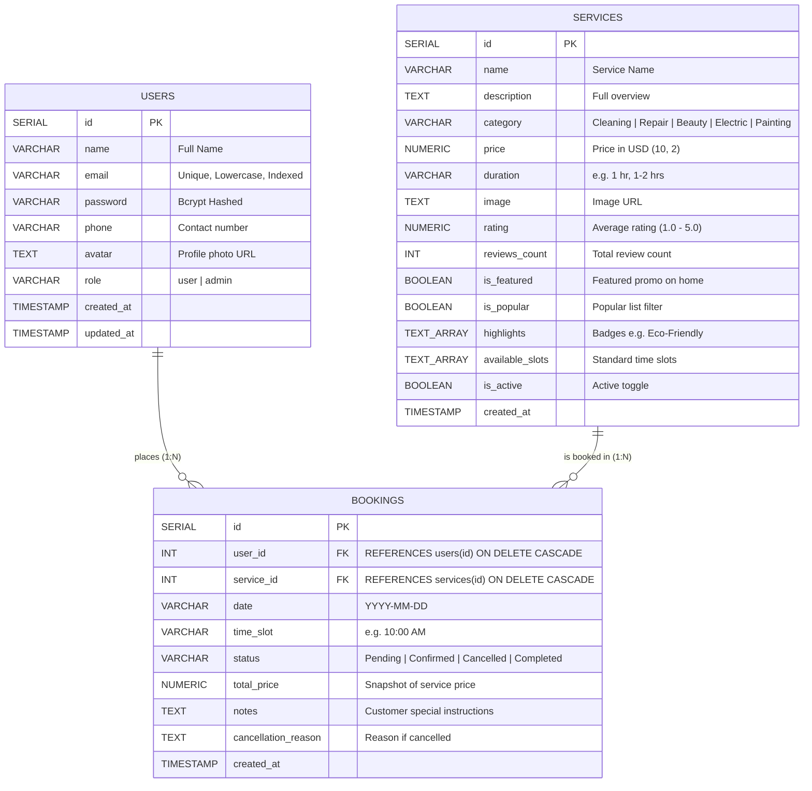

# 🗄️ Database Schema & PostgreSQL Architecture Documentation

## 1. Overview
The **ServiceHub** system uses **PostgreSQL** relational database for secure, relational, ACID-compliant persistence. The database consists of three relational tables with primary keys, foreign keys, cascading constraints, and optimized indexes:
1. **users**
2. **services**
3. **bookings**

---

## 2. Entity-Relationship (ER) Diagram



---

## 3. PostgreSQL DDL (Data Definition Language) Schema

```sql
-- 1. Users Table
CREATE TABLE IF NOT EXISTS users (
  id SERIAL PRIMARY KEY,
  name VARCHAR(255) NOT NULL,
  email VARCHAR(255) UNIQUE NOT NULL,
  password VARCHAR(255) NOT NULL,
  phone VARCHAR(50) DEFAULT '',
  avatar TEXT DEFAULT 'https://images.unsplash.com/photo-1494790108377-be9c29b29330?w=150',
  role VARCHAR(50) DEFAULT 'user',
  created_at TIMESTAMP DEFAULT CURRENT_TIMESTAMP,
  updated_at TIMESTAMP DEFAULT CURRENT_TIMESTAMP
);

-- 2. Services Table
CREATE TABLE IF NOT EXISTS services (
  id SERIAL PRIMARY KEY,
  name VARCHAR(255) NOT NULL,
  description TEXT NOT NULL,
  category VARCHAR(100) NOT NULL,
  price NUMERIC(10, 2) NOT NULL,
  duration VARCHAR(100) DEFAULT '1 hr',
  image TEXT NOT NULL,
  rating NUMERIC(2, 1) DEFAULT 4.8,
  reviews_count INT DEFAULT 120,
  is_featured BOOLEAN DEFAULT FALSE,
  is_popular BOOLEAN DEFAULT FALSE,
  highlights TEXT[] DEFAULT ARRAY['Experienced Staff', 'Quality Guaranteed', '100% Satisfaction'],
  available_slots TEXT[] DEFAULT ARRAY['09:00 AM', '10:00 AM', '11:00 AM', '02:00 PM', '03:00 PM', '04:00 PM'],
  is_active BOOLEAN DEFAULT TRUE,
  created_at TIMESTAMP DEFAULT CURRENT_TIMESTAMP
);

-- 3. Bookings Table
CREATE TABLE IF NOT EXISTS bookings (
  id SERIAL PRIMARY KEY,
  user_id INT REFERENCES users(id) ON DELETE CASCADE,
  service_id INT REFERENCES services(id) ON DELETE CASCADE,
  date VARCHAR(20) NOT NULL,
  time_slot VARCHAR(50) NOT NULL,
  status VARCHAR(50) DEFAULT 'Pending',
  total_price NUMERIC(10, 2) NOT NULL,
  notes TEXT DEFAULT '',
  cancellation_reason TEXT DEFAULT '',
  created_at TIMESTAMP DEFAULT CURRENT_TIMESTAMP
);

-- Indexes for performance & conflict validation
CREATE INDEX IF NOT EXISTS idx_services_category ON services(category);
CREATE INDEX IF NOT EXISTS idx_services_popular ON services(is_popular);
CREATE INDEX IF NOT EXISTS idx_bookings_user ON bookings(user_id);
CREATE INDEX IF NOT EXISTS idx_bookings_service_slot ON bookings(service_id, date, time_slot, status);
```

---

## 4. Setup & Initialization Instructions

1. Ensure PostgreSQL is installed and running on your system.
2. Create a database named `servicehub_db`:
   ```sql
   CREATE DATABASE servicehub_db;
   ```
3. Update `.env` credentials in `service_booking_backend/`:
   ```env
   DB_HOST=localhost
   DB_PORT=5432
   DB_NAME=servicehub_db
   DB_USER=postgres
   DB_PASSWORD=your_password
   ```
4. Run the automated table creation and seed script:
   ```bash
   npm run seed
   ```
